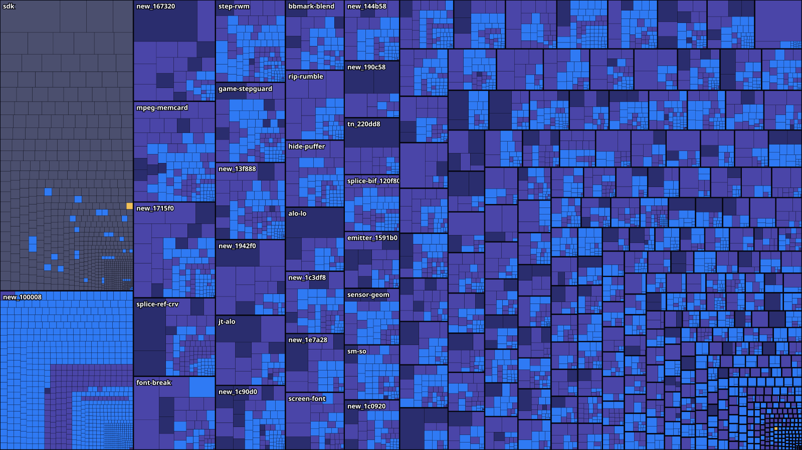

  
  
  

    A work-in-progress, byte-matching decompilation of Sly 2: Band of Thieves for PlayStation 2. 
    Reconstructing the original game code in readable C.

> [!WARNING]
> Rogue Byte does not include game data, executables, disc images, or proprietary toolchains. 
> A legitimately obtained copy of the **USA / NTSC-U** release (`SCUS_97316`) is required; the tools rebuild everything locally. 
> `src/` reconstructs game code function by function: see [src/README.md](src/README.md) and [THIRD_PARTY_NOTICES.md](THIRD_PARTY_NOTICES.md).

  
   
  Progress map of the code (blue: rebuilt from C and verified byte for byte; dark: not matched yet; grey: Sony's SDK).
  Live numbers on <a href="https://bytematch.dev/Blightwidow/rogue-byte">bytematch.dev</a>, details on the <a href="https://blightwidow.github.io/rogue-byte/">progress page</a>.

  

## Layout

| Path | What |
|---|---|
| `src/` | matched C/C++, one function per file, grouped by module ([src/README.md](src/README.md)) |
| `nonmatching/` | the best source that compiles for each unmatched function: starting points that count as partial work in the report ([nonmatching/README.md](nonmatching/README.md)) |
| `include/` | shared headers (`sly2.h`) and the assembler macros |
| `config/` | the Splat configuration and the retail layout ([config/README.md](config/README.md)) |
| `scripts/build/` | the image pipeline: split, link, pack, objdiff |
| `scripts/names/`, `scripts/ghidra/` | name recovery: the Sly 1 code matcher, headless Ghidra scripts |
| `scripts/decompile/`, `scripts/matching/` | decompilation helpers, compile-and-compare tooling for matching |
| `config/sly1/`, `config/recovered/` | inputs from the Sly 1 decompilation (CC0) and the recovered names, classes and modules |
| `site/` | the [progress page](https://blightwidow.github.io/rogue-byte/) and its data |
| `docs/` | [build](docs/build/building.md), [contributing](CONTRIBUTING.md) and [game](docs/game/executable-layout.md) notes |
| `tools/`, `work/` | git-ignored: the downloaded toolchain, your executables and local work |

## Getting started

1. `./setup.sh --sly2 /path/to/SCUS_973.16` checks your executable (USA, sha1 `de2af92a...`), creates `.venv` and downloads the
   toolchain into `tools/`.
2. `make elf` splits the executable with Splat, compiles `src/` with the original compiler, rebuilds the image and checks
   it byte for byte ([docs/build/building.md](docs/build/building.md)).
3. `make progress` writes the numbers behind the [progress page](docs/build/progress.md).

Name recovery needs more (Ghidra 12.1.4 with the ghidra-emotionengine-reloaded extension, Java 21, your Sly 1 executable):
[docs/build/name-recovery.md](docs/build/name-recovery.md) and [docs/build/decompilation.md](docs/build/decompilation.md).

Run every tool from this repository's root. `ROGUE_BYTE_DIR` overrides the detected repository root.

## License

GPL-3.0-or-later, see `LICENSE`. Third-party material and its licenses: `THIRD_PARTY_NOTICES.md`.
